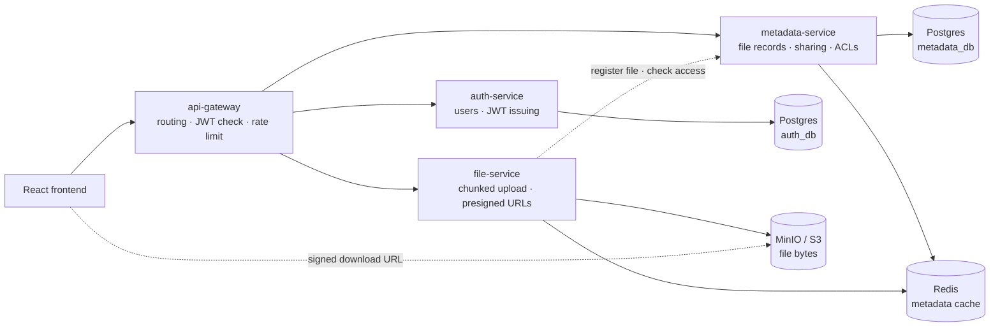

# CloudVault

A distributed file storage system in the spirit of Dropbox / Google Drive, built as microservices. Users register, upload files of any size through resumable chunked uploads, download them through short-lived signed URLs, and share files with other users by ID.

The whole stack runs locally with Docker Compose, or on Kubernetes (Docker Desktop).

**Stack:** Java 17 · Spring Boot 3.2 · Spring Cloud Gateway · React (Vite) · PostgreSQL · Redis · MinIO (S3-compatible) · Docker · Kubernetes

---

## Features

- **Authentication:** register, login and refresh with JWT access and refresh tokens. Passwords are hashed with BCrypt.
- **Chunked, resumable uploads:** the browser splits files into 8 MB chunks, and each chunk is uploaded and retried independently with exponential backoff. The server maps the chunks onto the S3 Multipart Upload API.
- **Signed downloads:** the file bytes are served straight from object storage through a pre-signed URL, never through the application servers.
- **File sharing by user ID:** every user has a share ID, visible in the profile badge. Files can be shared as Viewer or Editor, and shared files show up in the recipient's list.
- **Access control:** the download endpoint asks `metadata-service` whether the caller owns the file or has been given access. `file-service` never decides this on its own.
- **API gateway:** a single entry point that routes `/auth`, `/metadata` and `/files`, validates JWTs, and applies Redis-backed rate limiting.
- **Kubernetes manifests:** deployments with probes and resource limits, a ConfigMap and Secret split, a StatefulSet for Postgres, persistent volumes, and a CPU-based HPA for `file-service`.

---

## Architecture



### Design decisions

| Decision | Why |
|---|---|
| Metadata and file bytes live in separate services | Browsing folders and moving large files have very different load patterns, so they scale independently. Postgres holds only a pointer (`s3_key`) to the object. |
| One database per service (`auth_db`, `metadata_db`) | No cross-service table access, so each service can move to its own Postgres instance by changing only a connection string. |
| Every service validates the JWT itself | Defense in depth: no service trusts that the gateway already checked the token. |
| Upload session state lives in Redis (24 h TTL) | It is short-lived coordination data, not a permanent record. The permanent record is created in `metadata-service` only after S3 confirms the multipart upload is complete. |
| `file-service` asks `metadata-service` before presigning | `metadata-service` is the single source of truth for ownership and permissions. |
| CORS is configured once, at the gateway | Browsers only talk to the gateway. Duplicate CORS headers from the backend services get the response rejected by the browser. |

### Upload flow

```
1. POST /files/upload/init                   -> uploadId (S3 multipart upload created, session stored in Redis)
2. PUT  /files/upload/{id}/chunk/{n}  (xN)   -> each chunk becomes one S3 part, its ETag is recorded in Redis
3. GET  /files/upload/{id}/status            -> which chunks have arrived (used to resume)
4. POST /files/upload/{id}/complete          -> S3 assembles the object, then metadata-service gets the file record
```

---

## Project structure

```
cloudvault/
├── auth-service/        Spring Boot: registration, login, JWT issuing, BCrypt
├── metadata-service/    Spring Boot: file records, ownership, sharing, Redis cache
├── file-service/        Spring Boot: chunked upload, S3 multipart, presigned download URLs
├── api-gateway/         Spring Cloud Gateway: routing, JWT validation, rate limiting
├── frontend/            React + Vite: login, file browser, upload, share modal, profile badge
├── db-init/             Creates auth_db and metadata_db on first Postgres start
├── k8s/                 Kubernetes manifests (ConfigMap, StatefulSet, Deployments, HPA, optional Ingress)
├── docker-compose.yml   Full local stack
├── Makefile             up / down / logs / status / reset shortcuts
└── .env.example         Every configurable value, with placeholders
```

Each Spring Boot service follows the same layout: `config/`, `controller/`, `dto/`, `entity/`, `exception/`, `repository/`, `security/`, `service/`.

---

## API overview

All requests go through the gateway (`:8080`). Everything except register, login and refresh needs `Authorization: Bearer <accessToken>`.

| Service | Endpoint | Purpose |
|---|---|---|
| auth | `POST /auth/register` | Create an account |
| auth | `POST /auth/login` | Get access and refresh tokens |
| auth | `POST /auth/refresh` | Exchange a refresh token for a new pair |
| metadata | `GET /metadata/files` | Files you own plus files shared with you |
| metadata | `GET /metadata/files/{id}` | One file, if you have access |
| metadata | `POST /metadata/files` | Create a file or folder record |
| metadata | `PATCH /metadata/files/{id}` | Rename (owner or Editor) |
| metadata | `DELETE /metadata/files/{id}` | Delete (owner only) |
| metadata | `POST /metadata/files/{id}/share` | Share with a user ID as Viewer or Editor (owner only) |
| file | `POST /files/upload/init` | Start a chunked upload |
| file | `PUT /files/upload/{uploadId}/chunk/{n}` | Upload one chunk |
| file | `GET /files/upload/{uploadId}/status` | Received and missing chunks |
| file | `POST /files/upload/{uploadId}/complete` | Finish the upload and register the file |
| file | `DELETE /files/upload/{uploadId}` | Abort an upload |
| file | `GET /files/download?fileId=...` | Get a presigned download URL (access checked) |

---

## Running locally

### Prerequisites

- Docker Desktop
- Java **17** and Maven, only needed if you build outside Docker
- Node.js 20+, only needed for `npm run dev`

> Use JDK 17. Newer JDKs (for example 26) can break Lombok's annotation processing with Spring Boot 3.2.x.

### Option A: Docker Compose (quickest)

```bash
cp .env.example .env
# set JWT_SECRET to a real value:  openssl rand -base64 64
docker compose up -d --build
```

| What | URL |
|---|---|
| App | http://localhost:3000 |
| API gateway | http://localhost:8080 |
| MinIO console | http://localhost:9001 |

On Windows without `make`, use `docker compose ...` directly.

### Option B: Kubernetes (Docker Desktop)

1. Enable Kubernetes in Docker Desktop. Single-node `kind` is enough, but give WSL2 about 5 GB of RAM (`memory=5GB` in `~/.wslconfig`).
2. **Stop the Compose stack first** (`docker compose down`). Its containers hold the same ports (5432, 6379, 9000) and cause confusing bugs.
3. Build the images. The tags must match the `image:` lines in `k8s/*.yaml`:
   ```bash
   docker build -t cloudvault/auth-service:1.0.0     ./auth-service
   docker build -t cloudvault/metadata-service:1.0.1 ./metadata-service
   docker build -t cloudvault/file-service:1.0.2     ./file-service
   docker build -t cloudvault/api-gateway:1.0.0      ./api-gateway
   docker build -t cloudvault/frontend:1.0.1         ./frontend
   ```
4. Create the namespace and secret. Secrets are created on the cluster and are never committed:
   ```bash
   kubectl create namespace cloudvault
   kubectl create secret generic cloudvault-secrets -n cloudvault \
     --from-literal=POSTGRES_USER=cloudvault \
     --from-literal=POSTGRES_PASSWORD=<choose-a-password> \
     --from-literal=JWT_SECRET=<output of: openssl rand -base64 64> \
     --from-literal=MINIO_ROOT_USER=<minio-user> \
     --from-literal=MINIO_ROOT_PASSWORD=<minio-password> \
     --from-literal=S3_ACCESS_KEY=<same as MINIO_ROOT_USER> \
     --from-literal=S3_SECRET_KEY=<same as MINIO_ROOT_PASSWORD>
   ```
5. Apply the manifests:
   ```bash
   kubectl apply -f k8s/configmap.yaml -f k8s/db-init-configmap.yaml
   kubectl apply -f k8s/postgres.yaml -f k8s/redis.yaml -f k8s/minio.yaml
   kubectl apply -f k8s/auth-service.yaml -f k8s/metadata-service.yaml -f k8s/file-service.yaml
   kubectl apply -f k8s/api-gateway.yaml -f k8s/frontend.yaml
   kubectl apply -f k8s/hpa.yaml
   kubectl get pods -n cloudvault
   ```
6. Port-forward, one terminal each:
   ```bash
   kubectl port-forward -n cloudvault svc/frontend    3000:80
   kubectl port-forward -n cloudvault svc/api-gateway 8080:8080
   kubectl port-forward -n cloudvault svc/minio       9000:9000
   ```
   Then open http://localhost:3000.

`S3_PUBLIC_ENDPOINT` in `k8s/file-service.yaml` is the address placed in presigned URLs. It must be reachable from the **browser**, which is why it points at `localhost:9000`, not the in-cluster `minio` hostname.

---

## Known limitations

- **Large files over `kubectl port-forward`.** Uploads and downloads up to roughly 70 MB are verified end to end. A ~1 GB upload completed but produced a file that would not play, and a large video would not stream. `kubectl port-forward` is a single TCP tunnel meant for light API traffic, so sustained transfers through it are unreliable. This is a limit of the local access method. It still needs to be verified against a real ingress or load balancer, and ideally real S3.
- **Single replica by default.** The development machine this was built on has 8 GB of RAM. Only `file-service` has an HPA (CPU-based, 1 to 2 replicas).
- **Not yet load tested.** No throughput or latency numbers have been measured, so none are claimed here.
- **Schema management** uses `hibernate.ddl-auto: update`. Flyway or Liquibase migrations should replace it before any production use.
- **No automated tests yet.**

---

## Lessons learned

- **Case-sensitive package paths.** Windows tolerates a folder named `Repository` while the Java package says `repository`, but Spring's runtime class loading then fails with a `ClassNotFoundException`. Folder names must match package names exactly.
- **`kind` caches images by tag.** Rebuilding an image under the same tag with `imagePullPolicy: IfNotPresent` keeps serving the old code, so bump the tag on every rebuild.
- **Two MinIO instances on one port.** Compose and Kubernetes both bound `localhost:9000`, and the browser quietly talked to the wrong one. Stop Compose before using Kubernetes.
- **HPA needs resource requests, and memory-based scaling can feed back.** On a memory-constrained node, adding pods under memory pressure makes the pressure worse. CPU-only scaling with stabilization windows behaves far better.
- **Internal and public S3 endpoints differ.** Services reach MinIO as `minio:9000`, but a presigned URL has to carry an address the browser can resolve.
- **Windows can reserve port ranges** (Hyper-V / WSL2), making `kubectl port-forward` fail with "forbidden by its access permissions". Forward to a different local port if that happens.

---

## Roadmap

- [ ] Test large-file transfers behind a real Ingress or against real S3
- [ ] Load tests (k6) to get measured concurrency and latency numbers
- [ ] Unit and integration tests for each service
- [ ] Flyway migrations
- [ ] CI pipeline (build, test, image build)
- [ ] Proper folder navigation and move/rename in the UI
- [ ] Revoke a share, and list who a file is shared with
- [ ] Prometheus and Grafana dashboards

---

## License

This project is licensed under the [MIT License](LICENSE).
